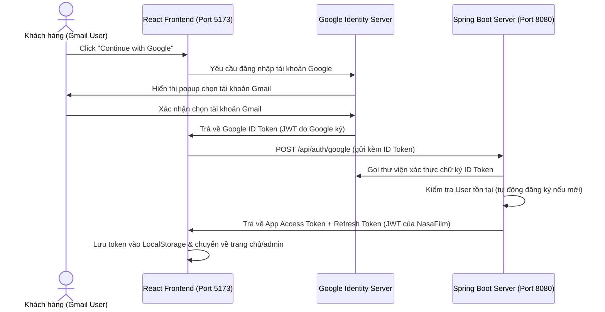

# 🎨 HƯỚNG DẪN CHẠY FRONTEND & ĐĂNG NHẬP GOOGLE (GMAIL) - NASAFILM

Tài liệu này hướng dẫn chi tiết cách thiết lập, khởi chạy giao diện Frontend của dự án **THDPV Movie Theater (NasaFilm)**, cấu hình tính năng Đăng nhập nhanh qua tài khoản Google (Gmail SSO) bằng Google Identity Services SDK.

---

## 📋 1. Yêu cầu Hệ thống & Môi trường

Trước khi tiến hành chạy, đảm bảo máy tính của bạn đã được cài đặt:
- **Node.js:** Phiên bản 20.x trở lên.
- **npm:** Phiên bản 10.x trở lên (thường đi kèm với Node.js).
- **Trình duyệt web:** Google Chrome hoặc Microsoft Edge (khuyên dùng để kiểm thử Google Login hoạt động trơn tru).

---

## ⚙️ 2. Các bước Thiết lập và Cài đặt

### Bước 2.1: Truy cập thư mục Frontend
Mở Terminal (Command Prompt hoặc PowerShell) tại thư mục gốc của dự án và di chuyển vào thư mục Frontend:
```bash
cd movie-theater-fe
```

### Bước 2.2: Cấu hình biến môi trường
Tạo file `.env` hoặc `.env.local` tại thư mục [movie-theater-fe](file:///d:/IT/TEAMJAVA/java_06_team_03/movie-theater-fe/) dựa trên file mẫu [.env.example](file:///d:/IT/TEAMJAVA/java_06_team_03/movie-theater-fe/.env.example):
- Trên Windows (PowerShell):
  ```powershell
  Copy-Item .env.example .env.local
  ```
- Trên Linux/macOS:
  ```bash
  cp .env.example .env.local
  ```

Mở file `.env.local` và kiểm tra/thiết lập các giá trị sau:
```env
# URL trỏ đến API Server Backend
VITE_API_URL=http://localhost:8080

# Chế độ môi trường phát triển
VITE_ENV=development

# Bật/tắt tính năng đăng nhập mạng xã hội
VITE_ENABLE_GOOGLE_LOGIN=true
VITE_ENABLE_APPLE_LOGIN=false

# Google Client ID (Dùng Client ID Web do quản trị viên cấu hình trên Google Cloud Console)
VITE_GOOGLE_CLIENT_ID=437474053343-5ijcjhd1vdctgp7gspfo1tsip5jc596d.apps.googleusercontent.com
```

> [!IMPORTANT]
> Giá trị `VITE_GOOGLE_CLIENT_ID` trên Frontend phải **khớp hoàn toàn** với biến `GOOGLE_WEB_CLIENT_ID` được khai báo trong file cấu hình `.env` của Backend (`movie-theater-be`). Nếu hai khóa này lệch nhau, Google sẽ báo lỗi xác thực ID Token.

---

## ☕ 3. Cơ chế tích hợp Google SDK trên Client

Ứng dụng NasaFilm sử dụng **Google Identity Services (GSI) SDK** dạng Client-side:

1. **Nhúng SDK vào ứng dụng:**
   Trong file [index.html](file:///d:/IT/TEAMJAVA/java_06_team_03/movie-theater-fe/index.html) của client, SDK Google được nhúng sẵn thông qua thẻ script:
   ```html
   <script src="https://accounts.google.com/gsi/client" async defer></script>
   ```

2. **Khởi tạo và Render nút đăng nhập:**
   Tại trang [LoginPage.jsx](file:///d:/IT/TEAMJAVA/java_06_team_03/movie-theater-fe/src/features/auth/pages/LoginPage.jsx), hệ thống tự động kiểm tra sự tồn tại của SDK (`window.google.accounts.id`) và khởi tạo nút:
   ```javascript
   window.google.accounts.id.initialize({
     client_id: googleClientId,
     callback: handleGoogleCredentialResponse
   });
   ```
   Sau đó, SDK sẽ tự động kết xuất nút Google gốc đẹp mắt vào phần tử có id `google-signin-button`.

---

## 🚀 4. Khởi chạy Ứng dụng Frontend

Chạy các lệnh sau tại thư mục `movie-theater-fe`:

1. **Cài đặt các thư viện phụ thuộc (Dependencies):**
   ```bash
   npm install
   ```

2. **Khởi động Local Development Server:**
   ```bash
   npm run dev
   ```
   Ứng dụng sẽ mặc định khởi chạy tại địa chỉ: **`http://localhost:5173`**

3. **Mở trình duyệt:** 
   Truy cập `http://localhost:5173/login` để chuyển đến màn hình đăng nhập. Tại đây, nút **"Continue with Google"** (hoặc "Đăng nhập nhanh bằng Google") sẽ xuất hiện ở phần đăng nhập nhanh.

---

## 🔒 5. Cơ chế Luồng đăng nhập Gmail (OAuth2 Flow)

Khi người dùng nhấn vào nút đăng nhập Google:



1. Người dùng chọn tài khoản Gmail trong cửa sổ popup bảo mật của Google.
2. Trình duyệt nhận về một **Google ID Token (dạng mã hóa JWT)**.
3. Frontend lấy token này và gửi lên Backend qua endpoint: `POST /api/auth/google` ([authService.js:L139](file:///d:/IT/TEAMJAVA/java_06_team_03/movie-theater-fe/src/features/auth/api/authService.js#L139)).
4. Backend kiểm chứng token, nếu hợp lệ sẽ trả về cặp Access Token và Refresh Token của riêng hệ thống NasaFilm.
5. Frontend lưu trữ thông tin tài khoản và mã thông báo vào LocalStorage với khóa `auth_user` và `token` để duy trì trạng thái đăng nhập.
