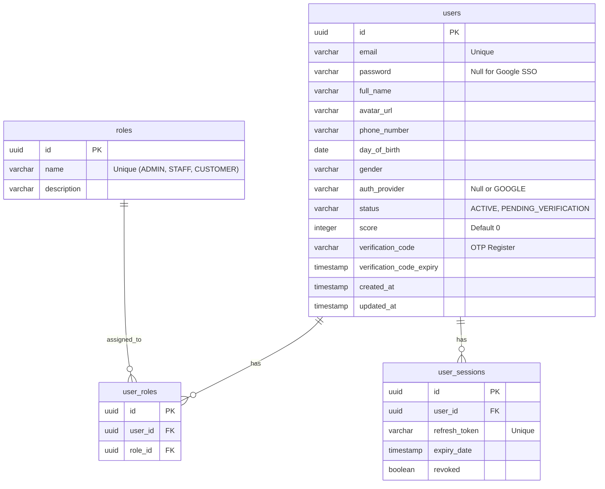

# 🗄️ TÀI LIỆU DATABASE & CẤU HÌNH DỮ LIỆU MẪU CHO USER GMAIL - NASAFILM

Tài liệu này đặc tả chi tiết cấu trúc các bảng cơ sở dữ liệu liên quan đến phân hệ Xác thực (Auth), so sánh sự khác biệt giữa tài khoản nội bộ và tài khoản Google SSO trong database, đồng thời hướng dẫn thiết lập dữ liệu mẫu (Seeding) phục vụ kiểm thử.

---

## 📊 1. Cấu trúc các Bảng Xác thực & Phân quyền hiện tại

Cơ sở dữ liệu PostgreSQL của NasaFilm hiện sử dụng các bảng sau để phục vụ việc xác thực:



---

## 🔄 2. So sánh Bản ghi User Thường (LOCAL) vs User Google (SSO)

Trong bảng `users` ([User.java](file:///d:/IT/TEAMJAVA/java_06_team_03/movie-theater-be/src/main/java/com/thdpv/movietheater/user/entity/User.java)), dữ liệu được lưu trữ khác nhau tùy thuộc vào phương thức đăng nhập:

| Thuộc tính (Column) | User thường đăng ký qua web (LOCAL) | User Đăng nhập qua Google (SSO) |
|---|---|---|
| **`password`** | Đầy đủ chuỗi băm BCrypt (Ví dụ: `$2a$10$...`) | `NULL` (Mật khẩu trống vì xác thực qua Google) |
| **`auth_provider`**| `NULL` (Hoặc mặc định là cục bộ) | `'GOOGLE'` |
| **`status`** | `'PENDING_VERIFICATION'` khi mới đăng ký. Chuyển sang `'ACTIVE'` sau khi nhập đúng OTP qua email. | Mặc định là `'ACTIVE'` ngay từ lần đầu đăng nhập thành công. |
| **`avatar_url`** | `NULL` (hoặc ảnh mặc định) | Chứa đường dẫn ảnh đại diện thực tế từ tài khoản Google (Ví dụ: `https://lh3.googleusercontent.com/...`) |

---

## 🛠️ 3. Cơ chế Khởi tạo dữ liệu mẫu (Data Seeding)

### 3.1. Dữ liệu mặc định từ hệ thống (DataSeeder)
Tại Backend, lớp [DataSeeder.java](file:///d:/IT/TEAMJAVA/java_06_team_03/movie-theater-be/src/main/java/com/thdpv/movietheater/config/DataSeeder.java) sẽ tự động chạy mỗi khi khởi động ứng dụng để kiểm tra và nạp sẵn:
* Danh sách 3 Vai trò cốt lõi vào bảng `roles`: `ADMIN`, `STAFF`, `CUSTOMER`.
* Một tài khoản quản trị viên tối cao (Admin) dựa trên cấu hình biến môi trường `APP_SEED_ADMIN_EMAIL` và `APP_SEED_ADMIN_PASSWORD` nếu chưa tồn tại trong database.

### 3.2. Đăng ký tự động cho User Google (Just-in-Time Provisioning)
Hệ thống **không yêu cầu** bạn phải chèn thủ công (Insert) dữ liệu của tài khoản Gmail test vào database trước. 
Khi bạn bấm "Continue with Google" trên Frontend lần đầu tiên:
1. Backend nhận ID Token, xác thực thành công thông tin email từ Google.
2. Hệ thống tìm kiếm email này trong bảng `users`:
   * **Nếu chưa tồn tại:** Tự động tạo mới một bản ghi User với `auth_provider = 'GOOGLE'`, trạng thái `status = 'ACTIVE'` và gán vai trò mặc định là `CUSTOMER`.
   * **Nếu đã tồn tại:** Cập nhật thông tin Họ tên, ảnh đại diện mới nhất từ Google Payload và tiếp tục đăng nhập.

---

## 📝 4. Hướng dẫn cấu hình nâng quyền cho User Gmail phục vụ Test

Khi bạn đăng nhập bằng Google lần đầu, tài khoản của bạn sẽ chỉ có quyền `CUSTOMER` (Khách hàng). Để test các chức năng Admin/Staff bằng tài khoản Gmail của bạn, hãy thực hiện các bước sau:

### Cách 1: Sử dụng câu lệnh SQL (Khuyên dùng)
Mở phần mềm quản lý Database (DBeaver, pgAdmin) kết nối vào database `movie_theater`, chạy chuỗi lệnh SQL sau:

```sql
-- 1. Tìm UUID của User Gmail của bạn
SELECT id, email, full_name FROM users WHERE email = 'dia_chi_gmail_cua_ban@gmail.com';

-- 2. Tìm UUID của Role ADMIN hoặc STAFF
SELECT id, name FROM roles WHERE name IN ('ADMIN', 'STAFF');

-- 3. Chèn quyền ADMIN cho User Gmail (Thay thế user_id và role_id tương ứng)
INSERT INTO user_roles (id, user_id, role_id)
VALUES (
    gen_random_uuid(), 
    'UUID_CỦA_USER_GMAIL_Ở_BƯỚC_1', 
    'UUID_CỦA_ROLE_ADMIN_Ở_BƯỚC_2'
);
```

### Cách 2: Sử dụng tài khoản Admin mặc định để cấp quyền
1. Đăng nhập vào hệ thống bằng tài khoản Admin hạt giống mặc định (`admin@nasafilm.com` / `admin123`).
2. Truy cập vào trang Quản trị thành viên tại địa chỉ: `http://localhost:5173/admin/users`.
3. Tìm kiếm tài khoản Gmail của bạn trong danh sách, chọn chức năng **Cập nhật vai trò (Role)** và đổi thành **ADMIN** hoặc **STAFF**.
4. Đăng xuất tài khoản Admin mặc định, và tiến hành đăng nhập lại bằng nút Google với Gmail của bạn để trải nghiệm giao diện Admin.
